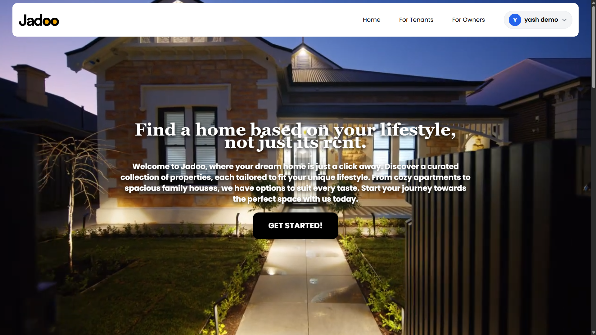
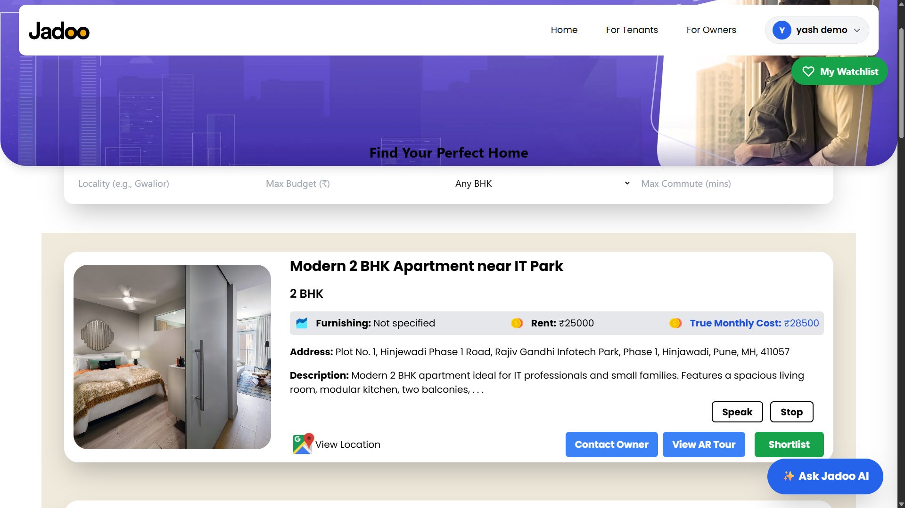
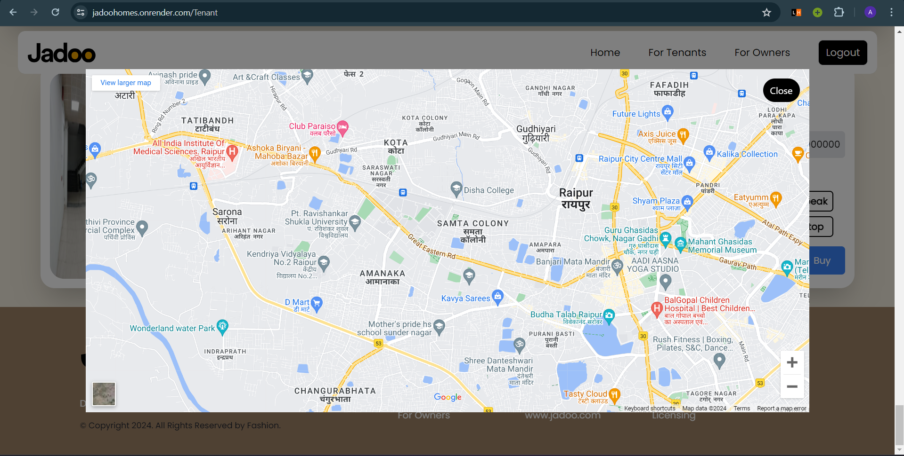
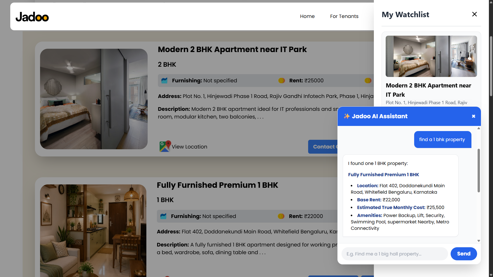
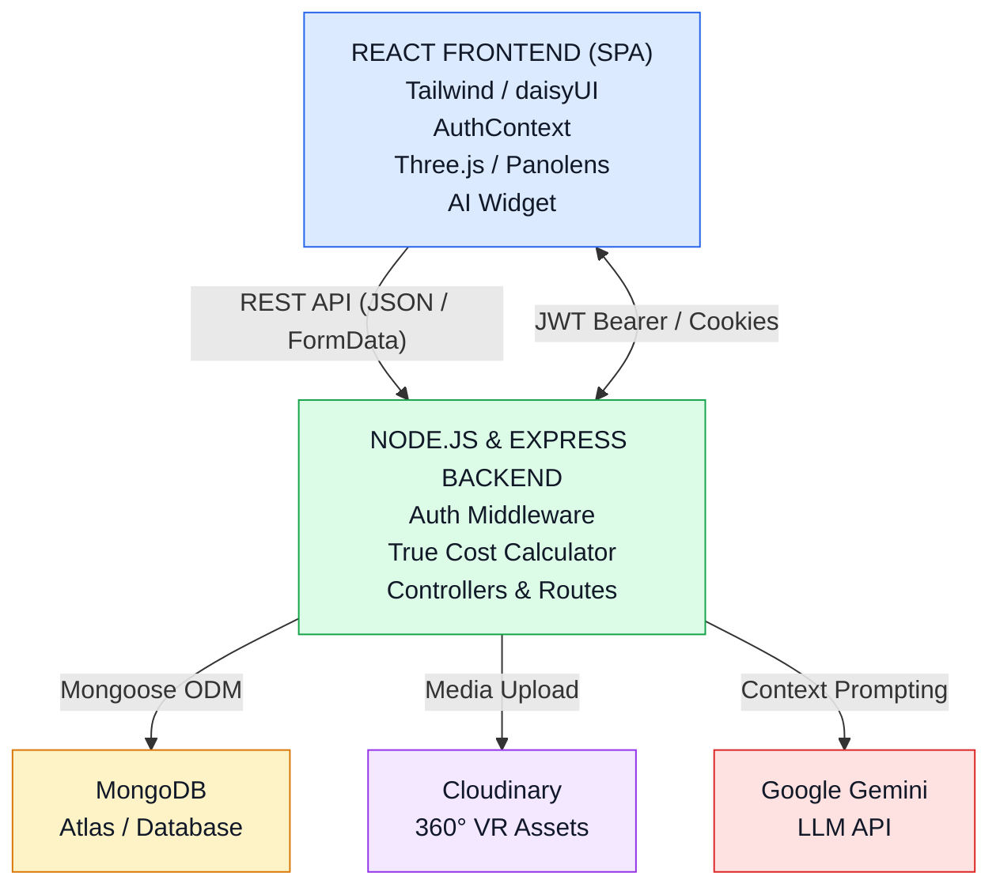
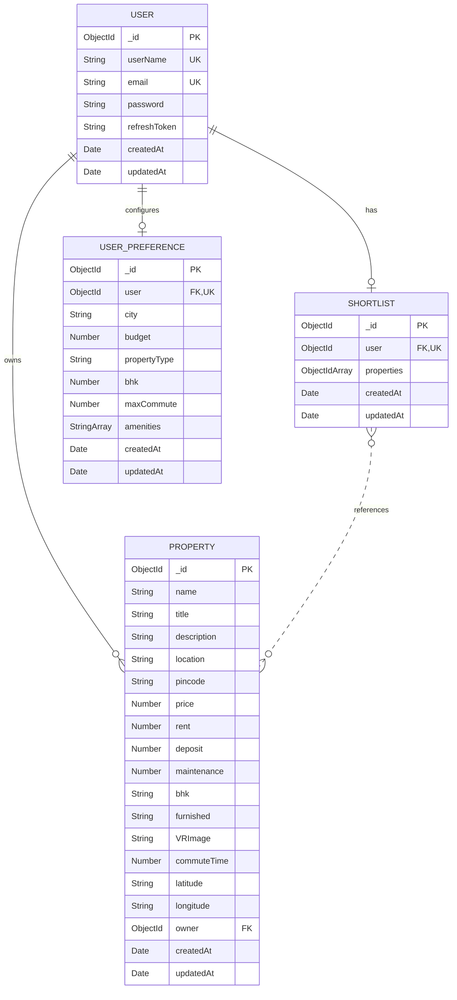

# 🏡 Jadoo - Smart Real Estate Platform

> *A platform to discover, explore, and connect with rental properties and homes across cities through AI-driven housing intelligence, True-Cost analysis, and immersive 360° AR/VR tours.*

## 📌 Table of Contents

- [🏡 Jadoo - Smart Real Estate Platform](#-jadoo---smart-real-estate-platform)
  - [📌 Table of Contents](#-table-of-contents)
  - [📖 Overview](#-overview)
  - [🎯 Problem Statement](#-problem-statement)
  - [✨ Key Features](#-key-features)
  - [🖼️ Screenshots](#️-screenshots)
  - [🛠️ Tech Stack](#️-tech-stack)
    - [Frontend](#frontend)
    - [Backend](#backend)
    - [Database](#database)
    - [Tools \& Deployment](#tools--deployment)
  - [🏗️ System Architecture](#️-system-architecture)
    - [1. Client Layer](#1-client-layer)
    - [2. API \& Business Logic Layer](#2-api--business-logic-layer)
    - [3. External Services \& Storage](#3-external-services--storage)
  - [📂 Project Structure](#-project-structure)
  - [⚙️ Getting Started](#️-getting-started)
    - [Prerequisites](#prerequisites)
    - [Installation](#installation)
  - [🔐 Environment Variables](#-environment-variables)
  - [📡 API Documentation](#-api-documentation)
    - [1. User Authentication (`/api/v1/users`)](#1-user-authentication-apiv1users)
    - [2. Properties \& Discovery (`/api/v1/property`)](#2-properties--discovery-apiv1property)
    - [3. Shortlist \& Comparison (`/api/v1/shortlist`)](#3-shortlist--comparison-apiv1shortlist)
    - [4. AI Property Assistant (`/api/v1/ai`)](#4-ai-property-assistant-apiv1ai)
  - [🗄️ Database Design](#️-database-design)
  - [🚀 Usage Guide](#-usage-guide)
  - [🛣️ Future Enhancements](#️-future-enhancements)
  - [🤝 Contributing](#-contributing)
  - [📄 License](#-license)
  - [📬 Contact](#-contact)


## 📖 Overview

**Jadoo** is a modern, AI-assisted rental discovery and immersive AR/VR real estate platform. Originally built to connect the online digital space with physical properties for real estate agents, Jadoo has evolved into a full-fledged **Housing Intelligence Platform**.

It serves both **tenants** relocating to unfamiliar cities and **property owners/agents** showcasing listings. By combining structured property data, transparent **True Monthly Cost** calculations, an **AI Property Assistant** powered by Google Gemini, side-by-side property shortlisting, and web-native **360° Virtual Reality (VR) walkthroughs**, Jadoo empowers users to find a home based on their lifestyle, not just its base rent.


## 🎯 Problem Statement

Relocating to or searching for rental homes in unfamiliar cities comes with significant challenges:

- **Hidden Monthly Costs:** Listed base rents rarely reflect the actual financial commitment once maintenance fees, security deposits, utilities, and commute expenses are factored in.
- **Remote Inspection Barriers:** Prospective tenants cannot physically visit dozens of properties across a new city, leading to wasted time on misleading listings.
- **Decision Overload & Trade-offs:** Comparing multiple properties across different localities, weighing higher rent against a shorter office commute or better amenities, is difficult without structured side-by-side analysis.
- **Fragmented Information:** Buyers and tenants struggle to get immediate, factual answers about specific property trade-offs without endlessly contacting brokers.


## ✨ Key Features

- **Property Listing & Discovery:** Browse curated rental homes and properties with rich metadata, locality context, and high-resolution media.
- **Advanced Search & Multi-Parameter Filters:** Filter properties dynamically by city/locality, maximum budget (evaluated against True Cost), BHK configuration, furnishing status (`Unfurnished`, `Semi-Furnished`, `Fully Furnished`), and maximum commute time.
- **True Monthly Cost Calculator:** Automatically computes and appends the transparent monthly cost (`Base Rent + Maintenance + Estimated Utilities + Parking + Estimated Transport`) to every property listing.
- **Immersive 360° VR Property Walkthroughs:** Web-native panoramic 360-degree virtual tours powered by Three.js, Panolens, and WebXR, allowing remote room inspection directly in the browser without external app downloads.
- **Jadoo AI Property Assistant:** A floating conversational AI widget powered by Google Gemini (`@google/generative-ai`), grounded strictly in database records to answer questions about shortlisted properties, cost breakdowns, and commute trade-offs.
- **Shortlisting & Side-by-Side Comparison:** Save favorite properties to a personal shortlist and compare 2 to 3 homes side-by-side to evaluate factual differences.
- **Secure User Authentication:** Full JWT-based authentication (`accessToken` and `refreshToken`) with `bcrypt` password hashing, HTTP-only cookies, and React `AuthContext` state management.
- **Property Listing Management (Agent/Owner Dashboard):** Dedicated interface for owners and agents to upload 360° VR images via Multer & Cloudinary, set geographic coordinates (`latitude`/`longitude`), and manage listings.
- **Contact Property Owners:** Direct owner/agent contact details integrated into property listings.
- **Responsive Modern UI:** Built with Tailwind CSS, daisyUI components, and Framer Motion for smooth animations across desktop and mobile devices.


## 🖼️ Screenshots

> *Replace the placeholder paths below with actual screenshots from your `images/` directory.*

| Landing Page & Hero | Property Discovery & Filters |
| :---: | :---: |
|  |  |

| 360° VR Virtual Walkthrough | Jadoo AI Chat Assistant & Shortlist |
| :---: | :---: |
|  |  |

---

## 🛠️ Tech Stack

### Frontend

- **React.js (v18.2):** Component-based Single Page Application (SPA) architecture.
- **React Router DOM (v6.22):** Client-side routing and navigation.
- **Tailwind CSS (v3.4) & daisyUI (v5.7):** Utility-first styling and modern UI components.
- **Three.js (v0.161) & Panolens (v0.12) / WebXR:** 3D rendering and interactive 360° equirectangular panoramic virtual tours.
- **Framer Motion:** Smooth UI transitions and animations.
- **React Speech Recognition & React Toastify:** Voice command support and interactive toast notifications.

### Backend

- **Node.js & Express.js (v4.22):** Asynchronous RESTful API server using ES Modules (`"type": "module"`).
- **Google Generative AI (`@google/generative-ai`):** Gemini LLM integration (`gemini-1.5-flash`) for the grounded AI Property Assistant.
- **JSON Web Token (`jsonwebtoken`) & `bcrypt`:** Token-based authentication, authorization middleware, and password hashing.
- **Multer & Cloudinary (`v2`):** Multipart form-data handling and cloud storage for 360° VR property images.

### Database

- **MongoDB & Mongoose (v8.24):** NoSQL document database with structured schemas for Users, Properties, UserPreferences, and Shortlists.

### Tools & Deployment

- **Render:** Cloud hosting for production Backend Web Service and Frontend static/web deployment.
- **GitHub Actions:** Automated CI/CD workflow (`.github/workflows/`) for continuous integration and deployment on push to `main`.
- **Postman / Thunder Client:** API endpoint testing and verification.

---

## 🏗️ System Architecture

Jadoo follows a clean decoupled Client-Server MVC architecture:



### 1. Client Layer

- The React frontend manages user authentication state through `AuthContext`.
- The `Tenant` view renders property cards and filters.
- Displays 360° panoramic property tours.
- Provides a floating `AiChatWidget` for AI-powered assistance.

### 2. API & Business Logic Layer

- Express.js handles incoming API requests.
- The `verifyJWT` middleware verifies authentication tokens.
- Property queries pass through the `trueCostCalculator` utility to calculate the actual cost of a property before returning responses.

### 3. External Services & Storage

- **Multer:** Temporarily buffers uploaded 360° VR images from property owners.
- **Cloudinary:** Stores and serves uploaded VR images.
- **File System (`fs.unlinkSync`):** Removes temporary local files after upload.
- **MongoDB:** Stores property documents retrieved to answer AI queries.
- **Google Gemini:** Processes AI queries using a grounded system prompt containing shortlisted property details and their calculated True Cost.

---

## 📂 Project Structure

```mermaid
flowchart TD
    ROOT["🏡 Jadoo--AR-VR-Real-Estate-Platform"]

    ROOT --> DOC["📚 doc/"]
    ROOT --> GH["⚙️ .github/"]
    ROOT --> CLIENT["💻 client/"]
    ROOT --> SERVER["🖥️ server/"]
    ROOT --> README["📄 README.md"]

    GH --> WORKFLOWS["workflows/<br/>GitHub Actions CI/CD"]

    DOC --> DOCFILES["Project documentation<br/>Requirements, design, architecture<br/>API and planning documents"]

    CLIENT --> CP["public/"]
    CLIENT --> SRC["src/"]
    CLIENT --> CPKG["package.json"]

    CP --> HTML["index.html"]
    CP --> MANIFEST["manifest.json"]

    SRC --> ASSETS["assets/"]
    SRC --> COMPONENTS["components/"]
    SRC --> CONTEXT["context/"]
    SRC --> OWNER["Owner/"]
    SRC --> PAGES["pages/"]
    SRC --> TENANT["Tenant/"]
    SRC --> APP["App.js"]
    SRC --> INDEX["index.js"]

    COMPONENTS --> NAVBAR["Navbar.jsx"]
    COMPONENTS --> CHAT["AiChatWidget.jsx"]
    CONTEXT --> AUTH["AuthContext.jsx"]
    OWNER --> FORM["PropertyForm.jsx"]
    PAGES --> HOME["Home.jsx"]
    PAGES --> START["Getstarted.jsx"]
    TENANT --> TENANTPAGE["Tenant.jsx"]
    TENANT --> CARD["Tenantcard.jsx"]

    SERVER --> TEMP["public/temp/"]
    SERVER --> SSRC["src/"]
    SERVER --> SPKG["package.json"]

    SSRC --> CTRL["controllers/"]
    SSRC --> DB["db/"]
    SSRC --> MW["middlewares/"]
    SSRC --> MODELS["models/"]
    SSRC --> ROUTES["routes/"]
    SSRC --> UTILS["utils/"]
    SSRC --> SAPP["app.js"]
    SSRC --> SINDEX["index.js"]

    CTRL --> UC["user.controller.js"]
    CTRL --> PC["property.controller.js"]
    CTRL --> SC["shortlist.controller.js"]
    CTRL --> AC["ai.controller.js"]

    DB --> DBINDEX["index.js"]

    MW --> AUTHMW["auth.middleware.js"]
    MW --> MULTER["multer.middleware.js"]

    MODELS --> UM["user.model.js"]
    MODELS --> PM["property.model.js"]
    MODELS --> UPM["userPreference.model.js"]
    MODELS --> SM["shortlist.model.js"]

    ROUTES --> UR["user.routes.js"]
    ROUTES --> PR["property.routes.js"]
    ROUTES --> SR["shortlist.routes.js"]
    ROUTES --> AR["ai.routes.js"]

    UTILS --> APIERR["ApiError.js"]
    UTILS --> APIRES["ApiResponse.js"]
    UTILS --> ASYNC["asyncHandler.js"]
    UTILS --> CLOUD["cloudinary.js"]
    UTILS --> COST["trueCostCalculator.js"]

    classDef root fill:#1d4ed8,color:#ffffff,stroke:#1e40af,stroke-width:2px
    classDef folder fill:#dbeafe,color:#172554,stroke:#60a5fa
    classDef file fill:#f3f4f6,color:#111827,stroke:#9ca3af
    class ROOT root
    class DOC,GH,CLIENT,SERVER,SRC,CP,ASSETS,COMPONENTS,CONTEXT,OWNER,PAGES,TENANT,TEMP,SSRC,CTRL,DB,MW,MODELS,ROUTES,UTILS folder
    class DOCFILES,WORKFLOWS,CPKG,HTML,MANIFEST,NAVBAR,CHAT,AUTH,FORM,HOME,START,TENANTPAGE,CARD,SPKG,UC,PC,SC,AC,DBINDEX,AUTHMW,MULTER,UM,PM,UPM,SM,UR,PR,SR,AR,APIERR,APIRES,ASYNC,CLOUD,COST,SAPP,SINDEX,APP,INDEX,README file
```



<!-- Plaintext
```text
Jadoo--AR-VR-Real-Estate-Platform/
├── 
├── .github/
│   └── workflows/                     # GitHub Actions CI/CD pipelines
├── client/                            # React Frontend Application
│   ├── public/
│   │   ├── index.html                 # HTML entrypoint
│   │   └── manifest.json              # PWA manifest configuration
│   ├── src/
│   │   ├── assets/                    # Static images and backgrounds (e.g., Tenantbg.jpeg)
│   │   ├── components/
│   │   │   ├── Navbar.jsx             # Responsive daisyUI navigation bar
│   │   │   └── AiChatWidget.jsx       # Floating Gemini AI Property Assistant
│   │   ├── context/
│   │   │   └── AuthContext.jsx        # Global JWT authentication context
│   │   ├── Owner/
│   │   │   └── PropertyForm.jsx       # Owner form for adding properties & VR images
│   │   ├── pages/
│   │   │   ├── Home.jsx               # Landing page view
│   │   │   └── Getstarted.jsx         # Login and Registration screens
│   │   ├── Tenant/
│   │   │   ├── Tenant.jsx             # Property discovery, search, and filters
│   │   │   └── Tenantcard.jsx         # Individual property card with shortlist action
│   │   ├── App.js                     # Main React component & router setup
│   │   └── index.js                   # React DOM root
│   └── package.json                   # Frontend dependencies & scripts
├── server/                            # Node.js & Express Backend
│   ├── public/temp/                   # Temporary directory for Multer uploads
│   ├── src/
│   │   ├── controllers/
│   │   │   ├── user.controller.js     # Register, login, logout, current user
│   │   │   ├── property.controller.js # Property CRUD, filters & True Cost injection
│   │   │   ├── shortlist.controller.js# Toggle shortlist, fetch & compare properties
│   │   │   └── ai.controller.js       # Grounded Gemini AI chat controller
│   │   ├── db/
│   │   │   └── index.js               # MongoDB connection setup
│   │   ├── middlewares/
│   │   │   ├── auth.middleware.js     # JWT verification (verifyJWT)
│   │   │   └── multer.middleware.js   # Multipart file upload middleware
│   │   ├── models/
│   │   │   ├── user.model.js          # User schema & token generation methods
│   │   │   ├── property.model.js      # Property schema with rental & geo fields
│   │   │   ├── userPreference.model.js# User onboarding preferences schema
│   │   │   └── shortlist.model.js     # User property shortlist schema
│   │   ├── routes/
│   │   │   ├── user.routes.js         # User auth endpoints
│   │   │   ├── property.routes.js     # Property CRUD & filter endpoints
│   │   │   ├── shortlist.routes.js    # Shortlist & comparison endpoints
│   │   │   └── ai.routes.js           # AI assistant chat endpoints
│   │   ├── utils/
│   │   │   ├── ApiError.js            # Standardized error class
│   │   │   ├── ApiResponse.js         # Standardized response wrapper
│   │   │   ├── asyncHandler.js        # Promise wrapper for Express controllers
│   │   │   ├── cloudinary.js          # Cloudinary upload & local file cleanup
│   │   │   └── trueCostCalculator.js  # Dynamic True Monthly Cost calculation
│   │   ├── app.js                     # Express app, CORS, cookies & route mounting
│   │   └── index.js                   # Server entrypoint
│   └── package.json                   # Backend dependencies & scripts
└── README.md                          # Project documentation
``` -->

## ⚙️ Getting Started

### Prerequisites

- **Node.js** (v18.x or higher recommended)
- **npm** (Node Package Manager)
- **MongoDB** (Local instance or MongoDB Atlas cluster URI)
- **Cloudinary Account** (For storing 360° VR property images)
- **Google Gemini API Key** (For the Jadoo AI Assistant)

### Installation

1. **Clone the repository:**

   Bash
   ```
   git clone [https://github.com/Yash-Padme/Jadoo--AR-VR-Real-Estate-Platform.git](https://github.com/Yash-Padme/Jadoo--AR-VR-Real-Estate-Platform.git)
   cd Jadoo--AR-VR-Real-Estate-Platform
   ```

2. **Install Backend & Frontend dependencies:**

   Bash
   ```
   # Install backend dependencies
   cd server
   npm install

   # Install frontend dependencies
   cd ../client
   npm install
   ```

3. **Configure environment variables:** Create a `.env` file inside the `server/` directory (see the [Environment Variables](#-environment-variables) section below for required keys).

4. **Start the backend server:**

   Bash
   ```
   cd ../server
   # Run in development mode with nodemon
   npm run dev
   # Or run in standard mode
   npm run start
   ```

   The backend server will start at `http://localhost:8000`.

5. **Start the frontend client:** Open a new terminal window and run:

   Bash
   ```
   cd client
   npm run start
   ```

   *The React app will launch in your browser at `http://localhost:3000`.*


## 🔐 Environment Variables

Create a `.env` file in the `server/` root directory and add the following variables using your own credentials:

Code snippet
```env
# Server Configuration
PORT=8000
NODE_ENV=development
CORS_ORIGIN=http://localhost:3000

# MongoDB Database
MONGODB_URI=mongodb+srv://<username>:<password>@cluster0.mongodb.net/JadooDB

# JWT Authentication Secrets
ACCESS_TOKEN_SECRET=your_super_secret_access_token_key_here
ACCESS_TOKEN_EXPIRY=1d
REFRESH_TOKEN_SECRET=your_super_secret_refresh_token_key_here
REFRESH_TOKEN_EXPIRY=10d

# Cloudinary Configuration (for 360° VR Images)
CLOUDINARY_CLOUD_NAME=your_cloudinary_cloud_name
CLOUDINARY_API_KEY=your_cloudinary_api_key
CLOUDINARY_API_SECRET=your_cloudinary_api_secret

# Google Gemini AI Configuration
GEMINI_API_KEY=your_google_gemini_api_key_here
GEMINI_MODEL=gemini-1.5-flash
```


## 📡 API Documentation

All API responses are standardized using the `ApiResponse` (`{ statusCode, data, message, success }`) and `ApiError` utility classes.

### 1. User Authentication (`/api/v1/users`)

| **Method** | **Endpoint** | **Auth Required** | **Description** | **Request Body / Params** |
| ---------- | ------------ | ----------------- | --------------- | ------------------------- |
| `POST` | `/register` | ❌ No | Register a new user account | `{ "userName", "email", "password" }` |
| `POST` | `/login` | ❌ No | Authenticate user & return JWT tokens | `{ "email", "password" }` |
| `POST` | `/logout` | ✅ Yes (`verifyJWT`) | Clear user session & tokens | — |
| `GET` | `/user` | ✅ Yes (`verifyJWT`) | Fetch currently logged-in user profile | Header: `Authorization: Bearer <token>` |

### 2. Properties & Discovery (`/api/v1/property`)

| **Method** | **Endpoint** | **Auth Required** | **Description** | **Request Body / Query Params** |
| ---------- | ------------ | ----------------- | --------------- | ------------------------------- |
| `GET` | `/` or `/getAllProperties` | ❌/✅ | Fetch properties with dynamic `trueMonthlyCost` & filters | Query: `?budget=30000&bhk=2&furnished=Fully Furnished&locality=Pune&maxCommute=30` |
| `GET` | `/:id` | ❌ No | Get single property details, `trueMonthlyCost`, & `virtualTour` payload | URL Param: `id` (Property ObjectId) |
| `POST` | `/addProperty` | ✅ Yes (`verifyJWT`) | Create a new property listing with 360° VR image upload | `multipart/form-data`: `name`, `title`, `description`, `location`, `pincode`, `price`, `size`, `type`, `area`, `amenities`, `contact`, `rent`, `deposit`, `maintenance`, `bhk`, `furnished`, `commuteTime`, `latitude`, `longitude`, `VRImage` (File) |
| `PUT` / `PATCH` | `/:id` | ✅ Yes (`verifyJWT`) | Update an existing property by ID | JSON fields to update |
| `DELETE` | `/:id` | ✅ Yes (`verifyJWT`) | Delete a property listing by ID | URL Param: `id` |

### 3. Shortlist & Comparison (`/api/v1/shortlist`)

| **Method** | **Endpoint** | **Auth Required** | **Description** | **Request Body** |
| ---------- | ------------ | ------------------- | -------------------------------------------------------------- | ---------------- |
| `POST` | `/toggle` | ✅ Yes (`verifyJWT`) | Add or remove a property from the user's shortlist | `{ "propertyId": "<ObjectId>" }` |
| `GET` | `/` | ✅ Yes (`verifyJWT`) | Get all shortlisted properties populated with `trueMonthlyCost` | — |
| `POST` | `/compare` | ✅ Yes (`verifyJWT`) | Fetch side-by-side comparison data for 2–3 properties | `{ "propertyIds": ["<id1>", "<id2>"] }` |

### 4. AI Property Assistant (`/api/v1/ai`)

| **Method** | **Endpoint** | **Auth Required** | **Description** | **Request Body** |
| ---------- | ------------ | ----------------- | --------------- | ---------------- |
| `POST` | `/chat` | ✅ Yes (`verifyJWT`) | Query Gemini AI about specific properties' costs, commute, & trade-offs | `{ "query": "Compare the true costs of my shortlisted properties", "propertyIds": ["<id1>", "<id2>"] }` |

---

## 🗄️ Database Design

Jadoo uses **MongoDB** with four primary Mongoose schemas:

1. **`User` (`user.model.js`)**
   - Fields: `userName` (String, unique, indexed), `email` (String, unique), `password` (String, bcrypt hashed), `refreshToken` (String), `timestamps`.
   - Methods: `isPasswordCorrect()`, `generateAccessToken()`, `generateRefreshToken()`.

2. **`Property` (`property.model.js`)**
   - Core Fields: `name`, `title`, `description`, `location`, `pincode`, `price`, `size`, `VRImage` (Cloudinary `secure_url`), `type`, `area`, `amenities`, `contact`, `owner` (`ObjectId` ref to `User`).
   - Housing Intelligence & Geo Fields: `rent` (Number), `deposit` (Number), `maintenance` (Number), `bhk` (String/Number), `propertyType` (String), `furnished` (String), `commuteTime` (Number, in mins), `transportDistance` (Number), `latitude` (String), `longitude` (String), `timestamps`.

3. **`Shortlist` (`shortlist.model.js`)**
   - Fields: `user` (`ObjectId` ref to `User`, unique), `properties` (Array of `ObjectId`s referencing `Property`), `timestamps`.

4. **`UserPreference` (`userPreference.model.js`)**
   - Fields: `user` (`ObjectId` ref to `User`, unique), `city` (String), `budget` (Number), `propertyType` (String), `bhk` (Number), `maxCommute` (Number), `amenities` (Array of Strings), `timestamps`.



## 🚀 Usage Guide

1. **Sign Up / Log In:** Navigate to the **Get Started** page (`/Getstarted`) to create a new account or log in. Your session token is automatically stored and managed via `AuthContext`.

2. **Search & Filter Properties:** Open the **Tenant** view to explore available properties. Use the search bar and filters to narrow down homes by locality, BHK, furnishing status, maximum commute time, and total budget.

3. **Analyze True Cost & Inspect in 360° VR:** Review each property card to see both the base rent and the calculated **True Monthly Cost**. Click on a listing to view full details, check locality context, and launch the interactive **360° VR Tour**.

4. **Shortlist & Ask Jadoo AI:** Click the **Shortlist** button on 2 or 3 property cards that interest you. Click the floating **✨ Ask Jadoo AI** button in the bottom corner and ask questions like:
   - *"Compare the true monthly costs of my shortlisted properties."*
   - *"Which property has a shorter commute time and lower maintenance fee?"*

5. **List a Property (For Owners/Agents):** Authenticated owners can fill out the property upload form with rental specifications, map coordinates, contact details, and a 360° panoramic image to publish a new listing.

## 🛣️ Future Enhancements

- **Side-by-Side Comparison Modal & Telemetry:** Complete dedicated visual comparison tables and full event analytics (`search_submitted`, `property_viewed`, `shortlist_added`).
- **Multiplayer Collaborative VR Tours:** Real-time WebSocket integration allowing real estate agents and clients to join the same 360° VR walkthrough simultaneously with spatial voice chat.
- **Dynamic AR Staging:** WebAR spatial overlays allowing users to drag and drop 3D furniture models (`.gltf`/`.obj`) into physical rooms via mobile camera streams.
- **3D Floor Plan Generator:** Automated conversion of 2D property floor plans into WebXR-compatible 3D layouts.
- **V2 Housing Intelligence:** AI-powered personalized housing scores, locality rent trend analysis, and automated document/owner verification.


## 🤝 Contributing

Contributions, issues, and feature requests are welcome!

1. Fork the repository.
2. Create a new feature branch:

   Bash
   ```
   git checkout -b feature/your-feature-name
   ```

3. Commit your changes with clear messages:

   Bash
   ```
   git commit -m "Add: description of your feature"
   ```

4. Push to your branch:

   Bash
   ```
   git push origin feature/your-feature-name
   ```

5. Open a **Pull Request** detailing your changes.

## 📄 License

This project is licensed under the **ISC License** (see `package.json` for details).

## 📬 Contact

- **Developer:** Yash Padme
- **GitHub Repository:** [https://github.com/Yash-Padme/Jadoo--AR-VR-Real-Estate-Platform](https://github.com/Yash-Padme/Jadoo--AR-VR-Real-Estate-Platform)
- **GitHub Profile:** [@Yash-Padme](https://github.com/Yash-Padme)
- **LinkedIn:** [Yash Padme](https://linkedin.com/in/yash-padme)
- **Live Backend URL:** [https://jadoo-ar-vr-real-estate-platform.onrender.com](https://jadoo-ar-vr-real-estate-platform.onrender.com)