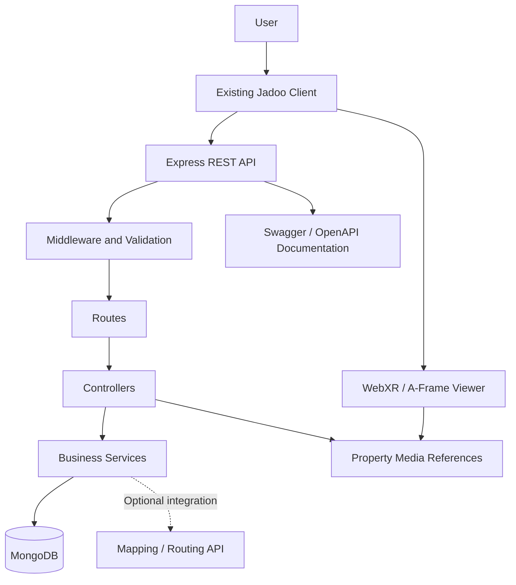

# 09. System Architecture: Jadoo

## 1. Overview

Jadoo is an existing JavaScript-based real-estate platform that supports property discovery and immersive property experiences. The rental decision-support MVP will extend this application with search, filtering, cost breakdowns, shortlisting, and property comparison.

The architecture follows a **client-server model** with an Express.js backend exposing REST APIs.

### Architecture Goals

- Extend the existing codebase without unnecessary rewrites.
- Separate frontend presentation from backend business logic.
- Store structured property information in a database.
- Support rental discovery and comparison efficiently.
- Preserve existing AR/VR functionality.
- Keep external integrations optional and independently manageable.

## 2. Technology Stack

| Layer | Technology | Responsibility |
|---|---|---|
| Frontend | Existing JavaScript client | User interface and interactions |
| Immersive experiences | WebXR, A-Frame | Virtual property experiences |
| Backend | Node.js | Server-side execution |
| API framework | Express.js | HTTP routes and middleware |
| API documentation | Swagger / OpenAPI | API exploration and documentation |
| Database | MongoDB, subject to existing configuration | Property and application data |
| Media | Images, 360° assets, 3D models | Property visualization |
| Version control | Git and GitHub | Source management |
| CI/CD | Existing GitHub Actions workflow | Automated validation and deployment |

**Implementation rule:** Verify the current repository configuration before adding or replacing dependencies. The table describes the known project stack and intended responsibilities, not a guarantee that every component is already fully implemented.

## 3. High-Level Architecture



The frontend communicates with the backend through HTTP APIs. The backend validates requests, executes application logic, and retrieves or updates persistent data.

External routing services should be integrated only when required for commute evaluation. Property media can be served through existing static assets or an appropriate media storage service.

## 4. Frontend Architecture

### Responsibilities

- Display property listings and detail pages.
- Collect search preferences.
- Apply filters and sorting.
- Show estimated monthly and upfront costs.
- Manage comparison selections.
- Display and update the shortlist.
- Render supported property images and immersive experiences.
- Present loading, empty, and error states.

### Proposed Feature Modules

```text
client/
├── pages/
│   ├── property-listing
│   ├── property-details
│   ├── property-comparison
│   └── saved-properties
├── components/
│   ├── PropertyCard
│   ├── PropertyFilters
│   ├── CostBreakdown
│   └── ComparisonTable
├── services/
│   └── propertyApi
└── existing immersive experience modules
```

This is a logical module proposal, not a requirement to create these exact paths. Adapt it to the actual frontend structure.

### Frontend Rules

- Reuse existing components and styling conventions.
- Keep API communication separate from presentation logic where practical.
- Avoid duplicating cost calculations across different pages.
- Preserve the existing virtual property viewer.
- Validate user input before submitting requests, while treating server-side validation as authoritative.

## 5. Backend Architecture

The backend should retain the existing Node.js and Express.js setup.

### Logical Request Flow

1. Client sends an HTTP request.
2. Express middleware processes the request.
3. Route matches the requested endpoint.
4. Validation checks parameters and payloads.
5. Controller handles the HTTP request and response.
6. Service executes business logic where separation is useful.
7. Model or data-access layer communicates with MongoDB.
8. The API returns a structured response.

### Proposed Backend Modules

```text
server/
├── routes/
│   ├── propertyRoutes.js
│   └── shortlistRoutes.js
├── controllers/
│   ├── propertyController.js
│   └── shortlistController.js
├── models/
│   ├── Property.js
│   └── Shortlist.js
├── services/
│   ├── propertyService.js
│   └── costCalculationService.js
├── middleware/
│   └── errorHandler.js
├── config/
│   └── database.js
└── server.js
```

Use these as proposed logical responsibilities. Reuse existing files and naming conventions wherever equivalent modules already exist.

### Separation of Responsibilities

- **Routes:** Define API endpoints and middleware.
- **Controllers:** Translate HTTP requests into application operations.
- **Services:** Implement reusable business rules.
- **Models:** Define and access persistent data.
- **Middleware:** Handle validation, authentication, and errors.
- **Configuration:** Manage database connections and environment settings.

## 6. API Design

Use REST conventions and JSON responses.

### Proposed Endpoints

| Method | Endpoint | Purpose |
|---|---|---|
| GET | `/api/properties` | Retrieve rental listings |
| GET | `/api/properties/:id` | Retrieve one property |
| GET | `/api/properties/filters` | Retrieve supported filter values, if needed |
| POST | `/api/shortlists` | Add a property to a shortlist |
| GET | `/api/shortlists/:userId` | Retrieve a user's saved properties, with authorization |
| DELETE | `/api/shortlists/:id` | Remove a shortlist entry |
| POST | `/api/properties/compare` | Retrieve comparison data for selected properties |

These are proposed contracts. Check existing routes before creating endpoints, and avoid exposing internal user identifiers as a substitute for proper authorization.

### Example Property Search

Request:

```http
GET /api/properties?city=Bangalore&minRent=10000&maxRent=20000&furnishing=Furnished
```

Illustrative response:

```json
{
  "success": true,
  "data": [
    {
      "id": "property_101",
      "title": "Furnished 1BHK Apartment",
      "locality": "Whitefield",
      "rent": 15000,
      "deposit": 45000,
      "maintenance": 1500,
      "furnishing": "Furnished"
    }
  ],
  "meta": {
    "total": 1
  }
}
```

The example is illustrative and does not represent a verified live property listing.

### API Design Rules

- Use consistent response structures.
- Validate query parameters and request bodies.
- Apply pagination to large result sets.
- Return appropriate HTTP status codes.
- Avoid exposing database internals.
- Document request parameters, responses, and errors in Swagger/OpenAPI.
- Enforce authorization for user-specific data.

## 7. Database Architecture

MongoDB is the intended data store, subject to verification of the existing database configuration.

### Main Collections

**Properties**

Stores listing information, rent, deposits, amenities, location, media references, and availability.

**Users**

Stores user information if the existing authentication system supports persistent user accounts.

**Shortlists**

Stores the relationship between users and saved properties when persistent, account-based shortlisting is implemented.

**Optional supporting collections**

- Property enquiries.
- Listing update history.
- Analytics events, if a separate event store is required.

For the initial curated dataset, property records can be seeded into the existing database. A new database should not be introduced without a concrete requirement.

## 8. Property Cost Calculation

Cost calculations should use a shared backend service or a single well-defined domain function.

### Estimated Monthly Cost

\[
C_m = R + M + U
\]

Where:

- \(R\) = monthly rent.
- \(M\) = monthly maintenance not included in rent.
- \(U\) = other known recurring charges not already counted.

### Estimated Upfront Payment

\[
C_u = R + D + B + O
\]

Where:

- \(R\) = first month's rent.
- \(D\) = refundable security deposit.
- \(B\) = disclosed brokerage.
- \(O\) = other disclosed upfront charges.

### Data Rules

- Do not count an expense twice.
- Do not treat unknown charges as zero.
- Distinguish confirmed amounts from estimates.
- Show incomplete totals when required inputs are unavailable.
- Validate monetary values before calculations.

The frontend may display calculated values, but the calculation rules must remain consistent across listing details and comparison views.

## 9. External Integrations

### Mapping and Routing

Purpose:
- Evaluate properties relative to a user's destination.
- Retrieve supported travel distances and estimated travel times.

Requirements:
- Use accurate property coordinates.
- Identify travel mode.
- Handle unavailable routes.
- Protect API credentials.
- Monitor usage limits and costs.

### Property Media

Purpose:
- Display photographs, floor plans, 360° tours, and 3D models.

Requirements:
- Associate media with the correct property.
- Support existing media formats.
- Provide fallbacks when immersive media is unavailable.
- Avoid duplicating large media assets unnecessarily.

### Authentication

Reuse the existing authentication mechanism if one is configured. If account-based shortlisting is not currently supported, decide whether to implement authentication or begin with session-based shortlisting.

## 10. Security and Reliability

- Validate inputs on the server.
- Protect private routes with appropriate authentication and authorization.
- Keep secrets in environment variables.
- Restrict cross-origin requests to trusted origins where applicable.
- Sanitize and validate user-controlled values.
- Apply rate limits to sensitive or expensive endpoints where appropriate.
- Avoid logging passwords, tokens, or unnecessary personal data.
- Handle database and external API failures gracefully.
- Use centralized error handling and appropriate logging.

## 11. Performance Considerations

- Add database indexes for frequently queried fields such as listing status, locality, rent, and property type.
- Use pagination for property search.
- Optimize images and lazy-load nonessential media.
- Avoid repeated database requests for the same comparison.
- Cache stable public data only where freshness requirements permit.
- Measure API response times before introducing complex optimization.

## 12. Deployment and CI/CD

Retain the existing deployment workflow unless the repository requires changes.

A suitable CI/CD sequence is:

1. Trigger on the configured branch or pull request.
2. Check out the repository.
3. Install dependencies.
4. Run linting and validation.
5. Execute automated tests where configured.
6. Build or package the application where applicable.
7. Deploy through the existing deployment provider.

Verify the actual GitHub Actions workflow before changing its triggers or deployment steps.

Production secrets must be configured through the deployment environment rather than committed to source control.

## 13. Observability

Track operational signals such as:

- API request count and latency.
- HTTP error rates.
- Database connection failures.
- Property search failures.
- External routing-service errors.
- Frontend runtime errors.
- Deployment failures.

Keep operational monitoring distinct from product analytics. Product analytics measures user behavior; observability measures system health.

## 14. Architecture Decisions

| Decision | Initial direction |
|---|---|
| Application structure | Extend the existing client-server application |
| Backend | Retain Node.js and Express.js |
| API style | REST with JSON |
| Database | Reuse existing MongoDB configuration if confirmed |
| Property inventory | Curated rental dataset for initial validation |
| Cost calculations | Shared, testable calculation rules |
| Virtual inspection | Preserve existing AR/VR functionality |
| Routing integration | Add only when needed for commute evaluation |
| Deployment | Reuse the existing CI/CD workflow |
| Advanced recommendations | Defer until the core workflow is validated |

## 15. Implementation Sequence

### Phase 1: Repository Assessment
- Inspect the frontend and backend directory structures.
- Identify existing routes, controllers, models, and authentication.
- Verify database configuration.
- Review the Swagger setup and deployment workflow.

### Phase 2: Rental Discovery
- Extend the property model.
- Implement or reuse property listing endpoints.
- Add search and filtering.
- Build listing and detail views.

### Phase 3: Decision Support
- Implement cost calculation.
- Add shortlisting.
- Build property comparison.
- Test missing-data scenarios.

### Phase 4: Location and Inspection
- Integrate supported commute information.
- Connect property media to the detail page.
- Preserve existing immersive experiences.

### Phase 5: Validation and Deployment
- Add automated tests.
- Verify API documentation.
- Instrument analytics.
- Test core user journeys.
- Deploy through the existing workflow.

## 16. Conclusion

Jadoo should evolve through incremental changes to its existing architecture. The proposed design retains the JavaScript client, Express.js REST backend, existing database configuration, and immersive property capabilities while adding the data and API workflows needed for rental decision support.

The next step is to define the database schema, relationships, indexes, and validation rules in `10-database-design.md`.