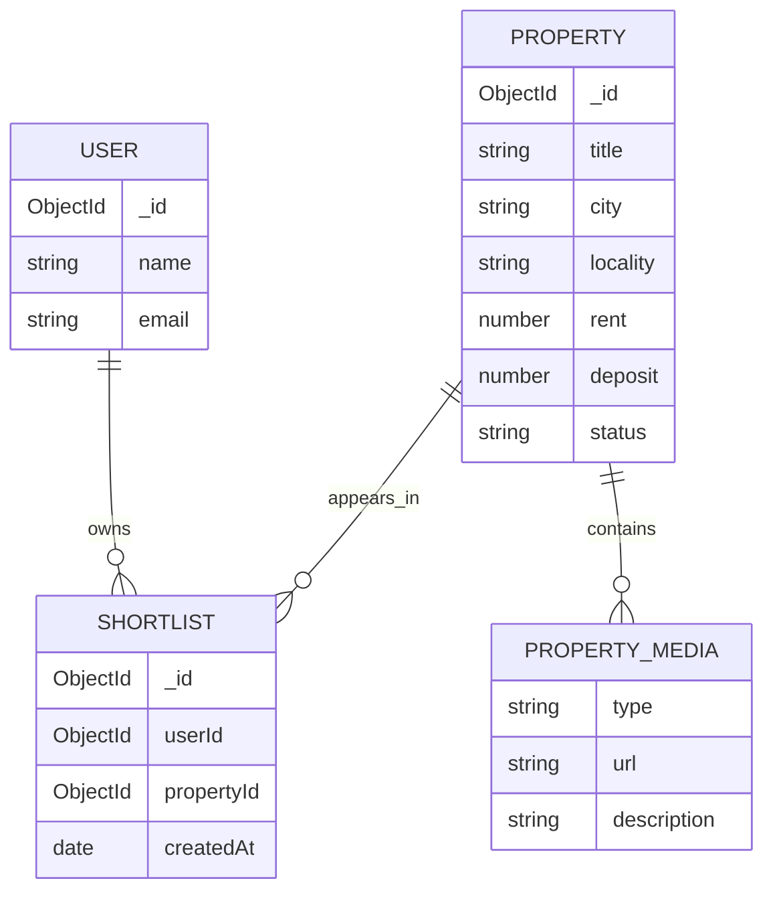

# 10. Database Design: Jadoo

## 1. Objective

Define the database structure required for Jadoo's rental property discovery MVP, including property records, user shortlists, validation rules, indexes, and example documents.

**Database:** MongoDB, subject to verification of the existing project configuration.

**Design principle:** Extend existing models where possible instead of introducing duplicate collections or replacing the current schema unnecessarily.

## 2. Database Requirements

The database must support:

- Retrieving available rental properties.
- Filtering by rent, locality, property type, furnishing, and amenities.
- Retrieving complete property details.
- Calculating monthly and upfront expenses.
- Saving and removing shortlisted properties.
- Retrieving standardized property comparison data.
- Storing property media references.
- Tracking listing availability and data freshness.

## 3. Entity Relationship Overview

Although MongoDB is document-oriented, the application has logical relationships between its records.



`PROPERTY_MEDIA` can be embedded inside a property document rather than stored as a separate collection. Embedding is the recommended initial approach when media metadata is relatively small.

## 4. Collection 1: Properties

**Purpose:** Store rental listing information.

### Proposed Schema

| Field | Type | Required | Description |
|---|---|---|---|
| `_id` | ObjectId | Yes | Unique property identifier |
| `title` | String | Yes | Property title |
| `description` | String | No | Property description |
| `propertyType` | String | Yes | Apartment, independent house, etc. |
| `listingType` | String | Yes | Rent or sale |
| `city` | String | Yes | City name |
| `locality` | String | Yes | Residential locality |
| `address` | String | No | Street address |
| `pincode` | String | No | Postal code |
| `location` | GeoJSON Point | No | Longitude and latitude |
| `rent` | Number | Conditional | Monthly rent |
| `deposit` | Number | No | Security deposit |
| `maintenance` | Number | No | Monthly maintenance |
| `brokerage` | Number | No | Disclosed brokerage |
| `furnishing` | String | Yes | Furnishing status |
| `bedrooms` | Number | No | Number of bedrooms |
| `bathrooms` | Number | No | Number of bathrooms |
| `amenities` | Array | No | Available amenities |
| `images` | Array | No | Property image references |
| `media` | Array | No | Videos, floor plans, or virtual tours |
| `contact` | Object | No | Owner or agent contact details |
| `status` | String | Yes | Availability status |
| `dataSource` | String | No | Origin of listing information |
| `lastVerifiedAt` | Date | No | Last verification timestamp |
| `createdAt` | Date | Yes | Creation timestamp |
| `updatedAt` | Date | Yes | Last update timestamp |

### Example Property Document

```json
{
  "_id": "671000000000000000000101",
  "title": "Furnished 1BHK Apartment",
  "description": "Illustrative rental property for MVP testing.",
  "propertyType": "Apartment",
  "listingType": "Rent",
  "city": "Bangalore",
  "locality": "Whitefield",
  "address": "Example residential address",
  "pincode": "560066",
  "rent": 15000,
  "deposit": 45000,
  "maintenance": 1500,
  "brokerage": null,
  "furnishing": "Furnished",
  "bedrooms": 1,
  "bathrooms": 1,
  "amenities": ["Parking", "Lift"],
  "images": [],
  "media": [],
  "contact": null,
  "status": "available",
  "dataSource": "demo",
  "lastVerifiedAt": null,
  "createdAt": "2026-10-20T00:00:00.000Z",
  "updatedAt": "2026-10-20T00:00:00.000Z"
}
```

This is a synthetic example, not a verified real-world listing. In MongoDB, `_id` should use an actual ObjectId rather than a string if the existing model uses ObjectIds.

### Important Validation Rules

- `title`, `city`, `locality`, `propertyType`, and `furnishing` must be valid strings.
- `listingType` must use a defined enumeration.
- Monetary values must be non-negative when supplied.
- `bedrooms` and `bathrooms` must be non-negative valid numbers.
- `status` must use defined values such as `available`, `unavailable`, or `draft`.
- Coordinates must follow the GeoJSON format.
- Unknown expenses must remain distinguishable from zero expenses.
- A property marked unavailable must not appear in active rental search results.

### Property Location Format

For GeoJSON, coordinates use **longitude first, latitude second**.

```json
{
  "type": "Point",
  "coordinates": [77.7500, 12.9700]
}
```

The coordinates above are illustrative. Production property records must use verified coordinates.

## 5. Collection 2: Users

**Purpose:** Associate persistent user preferences and saved properties with an authenticated account, if required by the existing application.

### Proposed Fields

| Field | Type | Description |
|---|---|---|
| `_id` | ObjectId | Unique user identifier |
| `name` | String | Display name |
| `email` | String | Account email |
| `preferences` | Object | Optional search preferences |
| `createdAt` | Date | Account creation time |
| `updatedAt` | Date | Last update time |

### Design Rules

- Reuse the existing authentication provider and user model.
- Do not store passwords in plaintext.
- If authentication is managed externally, store only the identifiers and profile information the application needs.
- Protect private user information with appropriate access controls.
- Do not create a separate user collection if an equivalent model already exists.

## 6. Collection 3: Shortlists

**Purpose:** Store properties saved by authenticated users.

### Proposed Schema

| Field | Type | Description |
|---|---|---|
| `_id` | ObjectId | Unique shortlist entry |
| `userId` | ObjectId or provider ID | User who saved the property |
| `propertyId` | ObjectId | Reference to a property |
| `createdAt` | Date | When the property was saved |

### Example Document

```json
{
  "_id": "671000000000000000000201",
  "userId": "671000000000000000000001",
  "propertyId": "671000000000000000000101",
  "createdAt": "2026-10-20T00:00:00.000Z"
}
```

### Constraints

- `userId` must correspond to the authenticated user.
- `propertyId` must reference a valid property.
- The same user must not have duplicate entries for the same property.
- Removing a shortlist entry must not delete the property.
- The backend must authorize every user-specific read and write.

If anonymous shortlisting is required, implement a separate session-based persistence strategy. Do not rely on a user-supplied ID for authorization.

## 7. Property Media

For the initial MVP, embed media metadata in the property document.

### Example

```json
{
  "media": [
    {
      "type": "image",
      "url": "/uploads/properties/property-101/living-room.jpg",
      "description": "Living room"
    },
    {
      "type": "floorplan",
      "url": "/uploads/properties/property-101/floorplan.png",
      "description": "Property floor plan"
    },
    {
      "type": "tour360",
      "url": "https://example.com/virtual-tour",
      "description": "360-degree virtual tour"
    }
  ]
}
```

These URLs are illustrative. Use actual approved asset locations in production.

Supported media types should be defined through an enumeration. Large binary assets should normally be stored in object or media storage, with references stored in MongoDB.

## 8. Database Indexes

Indexes should support the application's common query patterns.

| Index | Purpose |
|---|---|
| `{ status: 1, listingType: 1 }` | Retrieve active rental listings |
| `{ city: 1, locality: 1 }` | Filter by city and locality |
| `{ rent: 1 }` | Filter by rent range |
| `{ furnishing: 1 }` | Filter by furnishing |
| `{ propertyType: 1 }` | Filter by property type |
| `{ location: "2dsphere" }` | Support geographic queries |
| `{ userId: 1, propertyId: 1 }` unique | Prevent duplicate shortlist entries |

Create a compound index for shortlist uniqueness only after confirming the actual collection and field names.

Do not create every possible index by default. Validate indexes using actual queries and execution plans because excessive indexes increase write overhead.

## 9. Search Query Example

Illustrative MongoDB query for available rental properties in a specified city and rent range:

```javascript
db.properties.find({
  city: "Bangalore",
  listingType: "Rent",
  status: "available",
  rent: {
    $gte: 10000,
    $lte: 20000
  }
});
```

Use the exact field names and value conventions from the existing property model.

## 10. Cost Calculation Data Rules

Do not store a precomputed total as the only source of truth.

Use the underlying monetary fields to calculate:

**Estimated monthly cost**

`rent + known additional recurring charges`

**Estimated upfront payment**

`first month's rent + deposit + disclosed brokerage + other upfront charges`

Important rules:

- Do not count included maintenance twice.
- Treat `null` or missing values as unknown, not zero.
- Exclude unknown components from confirmed totals and indicate incompleteness.
- Distinguish refundable deposits from expenses that are not refundable.
- Recalculate totals whenever relevant source fields change.

A derived total can be cached for performance later, but only with an explicit invalidation strategy.

## 11. Data Seeding and Migration

### Initial Dataset

- Use curated demo records for development and user testing.
- Ensure all records satisfy the property schema.
- Assign unique identifiers.
- Include representative localities, price ranges, furnishing options, and amenities.
- Mark synthetic records as demo data.
- Avoid presenting sample properties as verified available listings.

### Migration Strategy

1. Inspect the existing property schema.
2. Identify fields that can be reused.
3. Add new fields without breaking existing functionality.
4. Write a migration or transformation script if existing records require conversion.
5. Test the migration against a backup or development dataset.
6. Verify listing, detail, AR/VR, and search workflows after migration.

## 12. Data Quality and Freshness

Each property should distinguish between the last update and the last verification.

- `updatedAt`: When the stored record was last modified.
- `lastVerifiedAt`: When availability or relevant listing details were last checked.

An update does not necessarily mean the property's availability has been verified.

Future enhancements may introduce field-level verification, listing expiration, and automated stale-listing review.

## 13. Privacy and Security

- Collect only the personal information required by the product.
- Restrict owner or agent contact details to appropriate application use.
- Never expose private user records through public property APIs.
- Validate identifiers and request parameters.
- Enforce ownership checks on shortlist operations.
- Avoid storing unnecessary sensitive information.
- Define retention and deletion behavior for user data.
- Obtain permission before importing or redistributing third-party property data.

## 14. Recommended Initial Data Model

For the first MVP release, use:

1. **Properties:** Core rental inventory, with embedded amenities and media metadata.
2. **Users:** Reuse the existing account model where applicable.
3. **Shortlists:** Separate collection for persistent authenticated shortlisting, if required.

Avoid introducing separate collections for every nested attribute unless querying, scale, or update patterns justify that complexity.

## 15. Conclusion

The database should support consistent rental search, transparent cost calculations, property comparison, and persistent shortlisting without unnecessary schema complexity.

The next step is to define how user interactions will be collected and analyzed in `11-analytics-plan.md`.