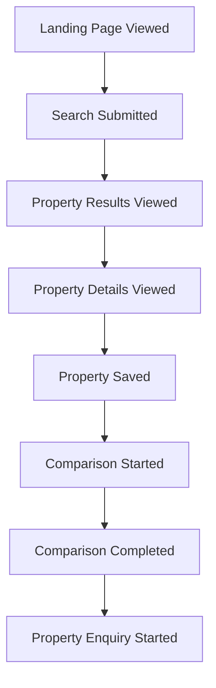

# 11. Analytics Plan: Jadoo

## 1. Objective

Define how Jadoo will collect, analyze, and interpret product usage data to determine whether the rental discovery MVP helps users find, evaluate, compare, and shortlist suitable properties.

Analytics should support product decisions, not merely count page views.

## 2. Analytics Goals

1. Understand how users discover rental properties.
2. Identify which filters users apply.
3. Measure engagement with property details.
4. Determine whether users use comparison and shortlisting features.
5. Identify friction in the rental-search funnel.
6. Measure progression from discovery to property enquiry.
7. Evaluate the impact of product experiments.

## 3. Key Questions

- Do users successfully find relevant properties?
- Which filters are used most frequently?
- Which property attributes receive the most attention?
- What percentage of users save at least one property?
- Do users compare properties before shortlisting?
- Where do users abandon the search journey?
- Does commute information influence shortlisting?
- Do virtual tours increase meaningful engagement?
- Which errors prevent users from completing core tasks?

## 4. Measurement Framework

Jadoo's analytics will follow the user journey.

This represents a possible path, not a mandatory sequence. Users may shortlist directly from search results, compare without saving, or initiate an enquiry before comparing.

## 5. Event Taxonomy

Use consistent, lowercase `snake_case` event names.

| Event | Trigger | Purpose |
|---|---|---|
| `landing_page_viewed` | Landing page opens | Measure initial visits |
| `search_submitted` | Search criteria submitted | Measure search intent |
| `property_results_viewed` | Results are displayed | Measure discovery |
| `filter_applied` | A filter changes results | Understand preferences |
| `filter_cleared` | A filter is removed | Measure search refinement |
| `property_viewed` | Property detail page opens | Measure property interest |
| `property_saved` | Property is added to shortlist | Measure shortlisting |
| `property_unsaved` | Property is removed | Understand changing preferences |
| `comparison_started` | Comparison view opens | Measure comparison adoption |
| `comparison_completed` | Comparison data is rendered successfully | Measure completed comparisons |
| `virtual_tour_opened` | Supported tour opens | Measure inspection engagement |
| `property_enquiry_started` | User initiates an enquiry | Measure progression toward contact |
| `search_no_results` | Search returns no properties | Identify inventory or filter problems |
| `api_error` | A tracked API operation fails | Diagnose technical friction |

**Implementation rule:** An event must represent an actual action or outcome. Opening a comparison page is not equivalent to successfully completing a comparison.

## 6. Event Properties

Events should include relevant contextual attributes.

| Property | Example | Purpose |
|---|---|---|
| `event_id` | Unique identifier | Deduplication |
| `timestamp` | ISO 8601 timestamp | Time-based analysis |
| `session_id` | Random session identifier | Session-level analysis |
| `user_id` | Pseudonymous identifier, if available | Returning-user analysis |
| `page_name` | `property_details` | Page context |
| `property_id` | Internal property identifier | Property-level analysis |
| `city` | `Bangalore` | Geographic segmentation |
| `min_rent` | `10000` | Search preference analysis |
| `max_rent` | `20000` | Search preference analysis |
| `filter_type` | `furnishing` | Filter usage |
| `result_count` | `12` | Search effectiveness |
| `comparison_count` | `3` | Comparison behavior |
| `tour_type` | `tour360` | Virtual inspection analysis |
| `error_code` | `PROPERTY_FETCH_FAILED` | Failure diagnosis |

These are proposed properties. Each event should include only the fields necessary for its analysis.

### Privacy Rules

- Do not send passwords, authentication tokens, phone numbers, or personal messages to analytics.
- Avoid collecting precise user location unless required, disclosed, and appropriately protected.
- Use pseudonymous identifiers where possible.
- Do not include full addresses or unnecessary personal information in event payloads.
- Respect applicable consent and privacy requirements.
- Define retention and deletion policies for analytics data.

## 7. Core Funnels

### Funnel A: Property Discovery

1. Landing page viewed.
2. Search submitted.
3. Property results viewed.
4. Property details viewed.

**Question:** Can users progress from initial intent to evaluating a property?

### Funnel B: Shortlisting

1. Property results viewed.
2. Property details viewed or shortlist action initiated.
3. Property saved.

**Question:** Can users identify and preserve properties that meet their requirements?

### Funnel C: Property Comparison

1. Property details viewed.
2. Multiple properties selected.
3. Comparison started.
4. Comparison completed.
5. A property saved or an enquiry initiated.

**Question:** Does the comparison workflow help users move toward a decision?

### Funnel D: Enquiry

1. Property details viewed.
2. Contact action selected.
3. Enquiry successfully initiated, if the system supports reliable confirmation.

**Question:** Does Jadoo help users progress from discovery toward real-world contact?

The exact funnel definitions must use consistent session or user-level windows and account for users who enter at different stages.

## 8. Segmentation

Analyze behavior across relevant dimensions.

### User Segment
- Relocating professional.
- Student or fresh graduate.
- Existing renter.

Only collect segment information when users voluntarily provide it or it can be derived appropriately.

### Search Behavior
- Rent range.
- Property type.
- Furnishing preference.
- Selected locality.
- Number of active filters.

### Property Characteristics
- Rent range.
- Locality.
- Furnishing.
- Availability of virtual media.
- Data completeness.

### Device
- Desktop.
- Mobile.
- Tablet.

### Acquisition Source
- Direct.
- Search engine.
- Referral.
- Campaign, where tracking is available and appropriate.

Avoid drawing strong conclusions from very small segments.

## 9. Instrumentation Strategy

### Step 1: Define an Event Specification

Maintain a central event dictionary containing:

- Event name.
- Trigger condition.
- Required properties.
- Optional properties.
- Owner or responsible module.
- Validation method.

### Step 2: Instrument the Frontend

Record interactions such as search submission, filter changes, property views, shortlist actions, and comparison interactions.

### Step 3: Instrument Backend Outcomes

Where necessary, record server-confirmed outcomes such as successful data retrieval or completed enquiry creation.

Do not assume that a frontend click means the backend operation succeeded.

### Step 4: Validate Events

Use development tools or analytics debugging facilities to verify that:

- Events fire at the correct time.
- Required properties are present.
- Failed actions are not reported as successful.
- Duplicate events are minimized.
- Sensitive data is excluded.

### Step 5: Build Reporting

Create reports for:

- Search and results performance.
- Property detail engagement.
- Shortlisting and comparison.
- Enquiry progression.
- Errors and missing data.
- Experiment outcomes.

## 10. Recommended Tools

Choose a single primary analytics platform initially.

Potential options include:

- **Google Analytics 4:** General web analytics, acquisition, and event-based reporting.
- **PostHog:** Product events, funnels, and user journey analysis.
- **A lightweight custom event log:** Suitable for early development if privacy, querying, and maintenance requirements are understood.

The final selection should consider existing integrations, cost, privacy requirements, event export options, and implementation effort.

Do not introduce multiple analytics platforms without a specific measurement need.

## 11. Reporting Cadence

### During Development
- Validate event firing after implementing each feature.
- Review errors and data quality before deployment.

### Weekly During MVP Testing
- Review search completion.
- Review property detail engagement.
- Review shortlist and comparison adoption.
- Investigate common user drop-off points.
- Examine technical failures and missing listing data.

### After Experiments
- Compare outcomes against predefined hypotheses.
- Evaluate whether observed differences are meaningful.
- Document limitations and resulting product decisions.

## 12. Analytics Quality Checklist

- [ ] Event names follow a consistent convention.
- [ ] Event definitions and properties are documented.
- [ ] Search events capture the relevant criteria.
- [ ] Property views use valid property identifiers.
- [ ] Shortlist events distinguish adding from removing.
- [ ] Comparison completion requires successful rendering.
- [ ] Errors are distinguishable from successful outcomes.
- [ ] Duplicate events are controlled.
- [ ] Personal data is minimized.
- [ ] Dashboard metrics use consistent denominators.
- [ ] Tracking is tested in development before release.

## 13. Expected Deliverables

1. Event dictionary.
2. Frontend and backend instrumentation.
3. Validated analytics events.
4. Core funnel reports.
5. Search and property engagement dashboard.
6. Data quality and error report.
7. Experiment measurement support.

## 14. Conclusion

Jadoo's analytics plan focuses on understanding whether users successfully progress from rental discovery to evaluation, comparison, shortlisting, and enquiry.

The next document defines the KPI framework, including precise metric definitions, denominators, measurement windows, and the process for setting targets from observed baseline data.